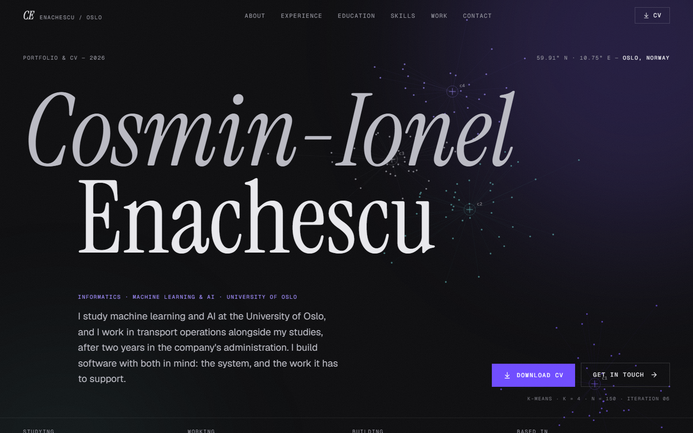
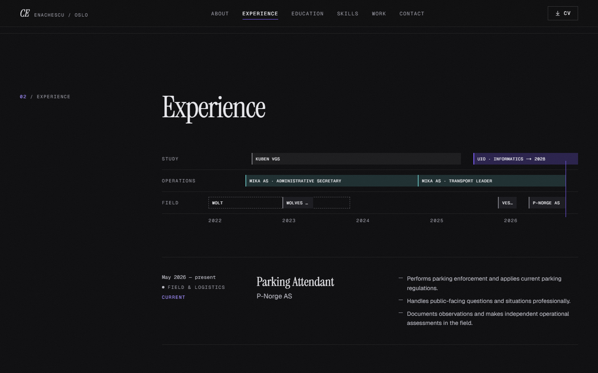
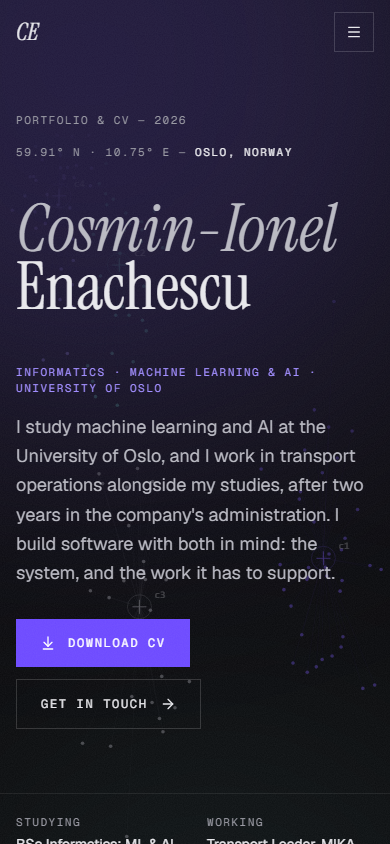
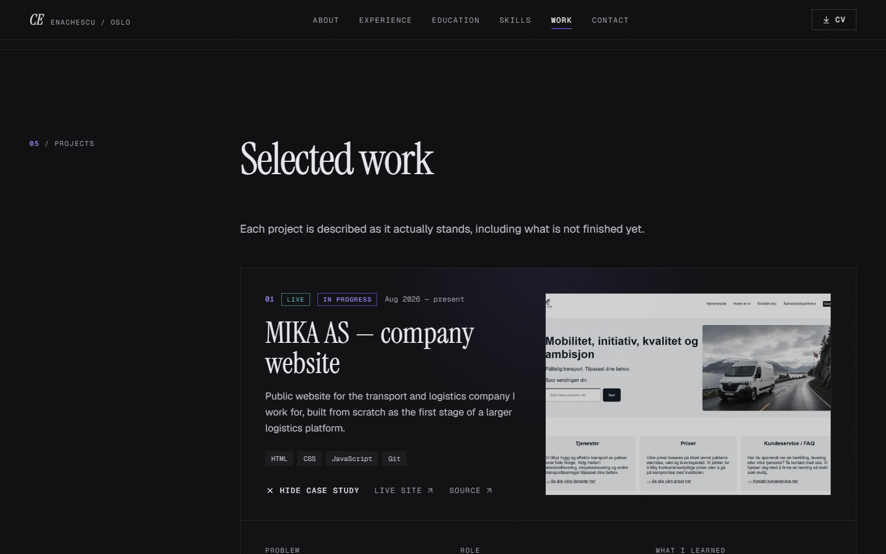

# Me — Cosmin-Ionel Enachescu

A bespoke personal portfolio and interactive CV. I'm an Informatics student at the University of Oslo (Machine Learning & AI), with professional experience in transport operations, administration and web development.



## Overview

One statically rendered page that covers who I am, my experience, education, skills, projects, licences and contact details. A print-styled `/cv` route is rendered from the same typed data and exported to an ATS-friendly PDF. Facts are kept in one place and written conservatively: no percentage skill bars, no invented metrics, and unfinished work is labelled as such.

## Technology stack

| Layer | Choice |
| --- | --- |
| Framework | Next.js 16 (App Router, static rendering), React 19 |
| Language | TypeScript |
| Styling | Tailwind CSS v4 with CSS design tokens |
| Motion | Motion (Framer Motion) — honours `prefers-reduced-motion` |
| Icons | lucide-react |
| Fonts | Instrument Serif, Geist, Geist Mono via `next/font` |
| Testing | Playwright end-to-end tests and axe-core (WCAG 2.1 AA) |

## Features

- **Live k-means hero**: a canvas that runs Lloyd's algorithm on 150 points in real time and labels each iteration. It reacts to the cursor, pauses when off-screen and becomes a static frame for reduced-motion users.
- **Honest skills ledger**: three tiers (Practical use / Currently developing / Academic foundations), each skill paired with its evidence, filterable and announced to screen readers.
- **Parallel timeline**: study, operations and field work drawn on one 2022–2026 axis, followed by a detailed role list.
- **Case-study cards** covering problem, role, stack, what is built, what is not yet built and what I learned, with cursor spotlight and expandable panels.
- **One data source for site and CV**: `src/content/*.ts` feeds both, and `npm run cv` prints the PDF.
- **Accessibility**: semantic landmarks, skip link, visible focus, keyboard-operable mobile menu (Esc closes and focus returns), AA contrast, reduced motion.
- **SEO**: metadata, Open Graph image, JSON-LD `Person`, sitemap and robots.

| Experience timeline | Mobile |
| --- | --- |
|  |  |



## Getting started

Requires Node.js 20.9 or newer.

```bash
git clone https://github.com/ConeCut/Me.git
cd Me
npm install
npm run dev            # http://localhost:3000
```

### Scripts

| Command | Purpose |
| --- | --- |
| `npm run build` | Production build |
| `npm run typecheck` / `npm run lint` | Static checks |
| `npx playwright install chromium` | One-off: browser for tests and the PDF |
| `npx playwright test` | End-to-end, accessibility and content-guard tests (run `npm run build` first) |
| `npm run cv` | Regenerate `public/cv.pdf` from `/cv` (run `npm run build` first) |

### Updating content

Edit the typed modules in `src/content/`, then run `npm run build && npm run cv && npx playwright test`.

## Deployment

The site is fully static, so it suits Vercel or any Node host:

1. Import the repository into Vercel (framework preset: Next.js).
2. Set the environment variable `SITE_URL` to the production origin (e.g. `https://example.com`). It is used for canonical URLs, Open Graph, the sitemap and robots.
3. Commit `public/cv.pdf` after content changes. It is generated locally, not during the hosted build.

## Licence

MIT. See [LICENSE](LICENSE).
